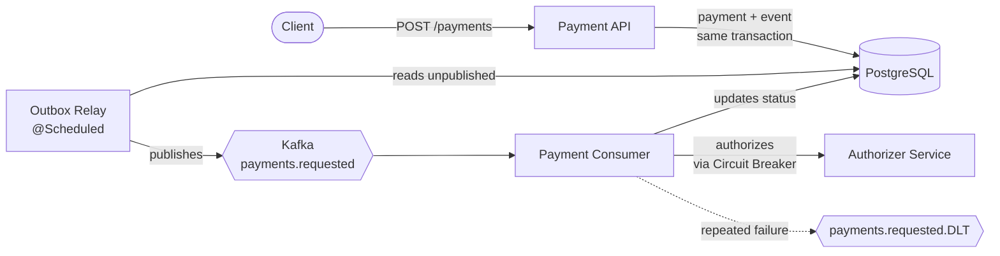
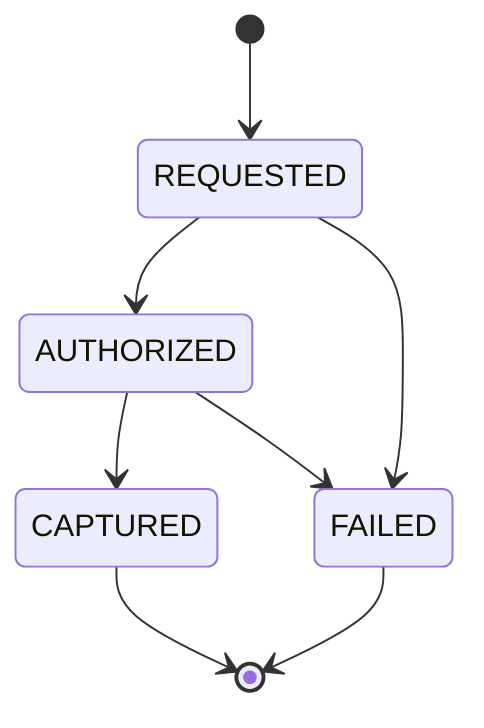

# 💸 Async Payment System

> An asynchronous, PIX-style payment processing system built with **hexagonal architecture** and **event-driven design**, showcasing resilience, consistency and decoupling in a realistic fintech scenario.

---

## 📌 About

Async payment system, PIX-style. A payment is created, authorized asynchronously against an external service, and moves through a REQUESTED → AUTHORIZED → CAPTURED/FAILED lifecycle. I built it to go deeper on event-driven architecture and the reliability problems that come with it. It was built as a portfolio project to demonstrate, in practice, patterns that usually only show up in large production systems. 

The patterns I used, and why, are in the table below.


---

## 🏛️ Architecture & decisions

The foundation is **hexagonal architecture (ports & adapters)**: the domain core knows nothing about Spring, Kafka or the database. Everything infrastructure-related enters through **adapters** that implement **ports** defined by the domain. This keeps the business rules testable in isolation and free to swap technology without touching the core.

### Patterns applied (and the reason for each)

| Pattern | Problem it solves |
|---|---|
| **Hexagonal (Ports & Adapters)** | Keeps the domain pure and framework-free; infrastructure is pluggable and the core is testable in isolation. |
| **Outbox Pattern** | Eliminates the *dual-write*: the payment and its event are written in the **same database transaction**; a scheduled relay publishes to Kafka afterwards. There is never an event without a payment, nor a payment without an event. |
| **Circuit Breaker + Fallback** (Resilience4j) | Protects the system when the external authorizer service is down: instead of hanging on timeouts, the circuit opens and a fallback responds in a controlled way. |
| **Dead Letter Queue (DLT)** | Messages that repeatedly fail during consumption are routed to a dead-letter topic instead of blocking the queue or being lost. |
| **Idempotency (2 layers)** | (1) A unique `idempotencyKey` per request prevents the same payment from being created twice; (2) the consumer only processes payments still in `REQUESTED`, ignoring redeliveries. |
| **State Machine** | Status transitions only through valid paths (`REQUESTED → AUTHORIZED → CAPTURED/FAILED`), with invalid transitions rejected inside the domain itself. |
| **JWT (stateless auth)** | Session-less authentication via a custom filter, allowing horizontal scaling with no shared state. |

### Payment flow



### Status lifecycle



---

## 🧰 Tech stack

- **Java 21** + **Spring Boot 3.3.5**
- **Spring Kafka** - event-driven messaging
- **PostgreSQL** + **Spring Data JPA** + **Flyway** (migrations)
- **Resilience4j** - circuit breaker and fallback
- **Spring Security + JWT** (jjwt 0.12.6) - stateless authentication
- **springdoc / OpenAPI** - API documentation and Swagger UI
- **MapStruct** - mapping between layers
- **Actuator + Micrometer/Prometheus** - metrics and observability
- **JUnit 5 + Mockito + Testcontainers** - unit and integration testing

---

## 🗂️ Repository structure

```
async-payment-system/
├── src/                  # Payment service (main application)
├── pom.xml
├── docker-compose.yml    # Postgres, Kafka, Kafka UI, Authorizer
├── authorizer/           # External authorizer service (stub dependency)
│   ├── src/
│   ├── pom.xml
│   └── Dockerfile
└── README.md
```

The Authorizer is a small separate service that approves or declines payments. In production this would be an external acquirer or bank. Here it's a stub, mostly so the circuit breaker has a real service to call.

---

## ▶️ Running locally

**Prerequisites:** Java 21, Docker and Docker Compose.

```bash
# 1. Start infrastructure + authorizer (Postgres, Kafka, Kafka UI, Authorizer)
docker compose up -d --build

# 2. Run the payment application
./mvnw spring-boot:run
```

| Service | Port |
|---|---|
| Payment API | `8081` |
| Authorizer | `8082` |
| Kafka UI | `8080` |

Interactive API docs (Swagger UI): `http://localhost:8081/swagger-ui.html`

---

## 📡 Main endpoints

| Method | Route | Description |
|---|---|---|
| `POST` | `/auth/login` | Authenticates and returns a JWT token |
| `POST` | `/payments` | Creates a payment order (requires Bearer token) |
| `GET` | `/payments/{id}` | Retrieves a payment |

All endpoints except `/auth/**` and the Swagger routes require a `Bearer <token>` header.

---

## 🧪 Tests

- **Unit - domain** (`PaymentTest`): construction invariants and state transitions, no framework.
- **Unit - application** (`PaymentServiceTest`): 6 scenarios with Mockito (idempotency, new payment, not found, skip-if-already-processed, authorized, declined).
- **Integration** (Testcontainers): spins up **real Postgres and Kafka** in disposable containers to validate the application context - a self-sufficient test that runs on any machine with Docker, with no infrastructure started by hand.

```bash
./mvnw test
```

---

## 🗺️ Roadmap

Next layers planned to evolve the project from "application" to "system":

- [ ] **CI/CD** with GitHub Actions (build, tests and vulnerability/CVE scanning in the pipeline)
- [ ] **AWS deployment** (containerization + ECS/RDS via IaC)
- [ ] **Full observability** (Prometheus + Grafana)
- [ ] **CQRS** with a MongoDB read model for query history

---

## 👤 Author

**Thallis Ferreira** - Backend Developer (Java)

- LinkedIn: [thallis-ferreira-dev-java](https://linkedin.com/in/thallis-ferreira-dev-java)
- GitHub: [@THenriqueh](https://github.com/THenriqueh)
